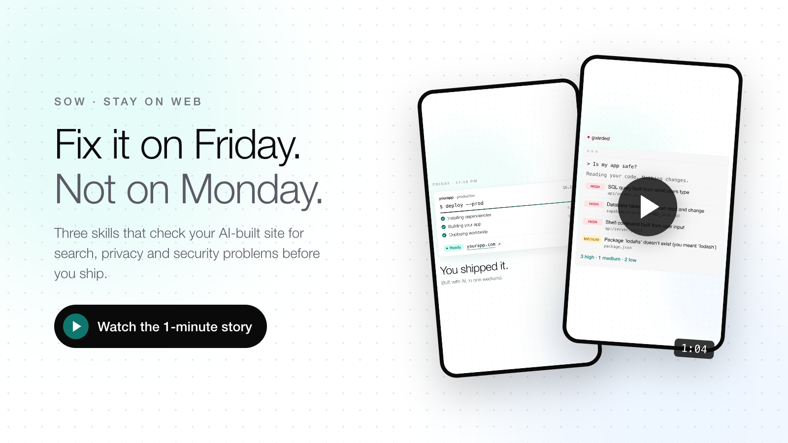

<p align="center">
  
</p>

<p align="center">
  <a href="https://github.com/Nithish-Yenaganti/sow/actions/workflows/ci.yml"></a>
  <a href="LICENSE"></a>
  
  
</p>

# SOW — Stay On Web

**Helpers for your AI coding assistant that make sure your website can be found, is set up the right way, and doesn't ship the security holes AI-written code tends to have.**

<p align="center">
  <a href="https://youtube.com/shorts/3wjLUe5T70M"></a>
</p>

## Why we made this

Today anyone can build a website in an afternoon with an AI coding assistant. But three things often go wrong after that:

1. **Nobody can find it.** Google doesn't show it, and ChatGPT never mentions it.
2. **It's missing the rules.** No privacy policy, no cookie notice, no refund policy, or code you aren't allowed to use.
3. **It has security holes.** SQL injection, leaked API keys, a database anyone can read, an AI feature that can be tricked, or a package the AI made up.

Most people only find out much later. SOW gives your coding assistant three skills that check for these problems, explain them in simple words, and fix them, but only when you say yes.

## The three skills

### findable: "Can people find my website?"

findable is a **technical SEO, AEO and GEO** tool. In plain words: it makes sure Google can list your site (SEO), answer tools can quote it (AEO), and AI tools like ChatGPT can read and mention it (GEO). It works on your site itself, its code and pages. It is **not** a full marketing SEO service: it doesn't buy ads, build backlinks or plan content.

| Topic | What it checks |
|---|---|
| **Google** | Can Google find and list every page? |
| **AI** | Can ChatGPT, Claude and Perplexity read your pages? |
| **Blocked** | Is something accidentally keeping search engines out? |
| **Empty** | Do some pages look blank to robots? |
| **Titles** | Does every page have a clear name and summary? |
| **Answers** | Are there short answers AI tools can quote? |
| **Mentions** | Do AI answers mention you, or someone else? *(optional)* |
| **Keywords** | Which searches could you win? *(optional)* |

Tested on 12 real websites. [Read more about findable →](skills/findable)

### compliance: "Is my website set up the right way?"

| Topic | What it checks |
|---|---|
| **Privacy** | Do you explain what personal data you collect and why? |
| **Cookies** | Do trackers wait until visitors say yes? |
| **Rights** | Can users delete or download their data? |
| **Payments** | Are refunds, renewals and cancelling clear? |
| **AI** | Do you tell people when they're talking to AI? |
| **Licenses** | Are you allowed to use your code, fonts and images? |
| **Claims** | Are you promising things you can't prove? |
| **Safety** | Are passwords and secret keys kept safe? |

Tested on 8 open-source projects. [Read more about compliance →](skills/compliance)

> compliance is not a lawyer. Every policy it writes is a draft for a lawyer to check.

### guarded: "Is my app safe from the usual attacks?"

| Topic | What it checks |
|---|---|
| **AI tools** | Can a file in your repo make Cursor, Copilot or Claude Code run commands? (auto-approve, risky MCP servers, hidden instructions) |
| **Keys** | Are secret keys in your code, in git, or sent to the browser? |
| **Data** | Can anyone read or change your Supabase or Firebase data? |
| **Injection** | Are database queries or shell commands built from what users type? |
| **AI features** | Can hidden instructions trick your AI into misusing its tools or leaking data? |
| **Browser** | Can someone run their own script on your pages (XSS)? |
| **Server** | Can callers make your server fetch any URL or read any file? |
| **Packages** | Did the AI add a package that doesn't exist, is malware, or has a known CVE? *(optional, online)* |

Tested on 14 open-source projects, including MCP servers with published CVEs. [Read more about guarded →](skills/guarded)

> guarded is a code check, not a penetration test. It never attacks anything, and never calls your app "secure".

## How it works

1. You ask your coding assistant, like: "Why doesn't my site show up in Google?"
2. It looks at your website. Looking never changes anything.
3. It tells you what's wrong, in simple words.
4. You pick what to fix, and see every change first.
5. It fixes those things and checks that they worked.

It never publishes anything for you, and you don't need any accounts or keys.

## Install

You need [uv](https://docs.astral.sh/uv/getting-started/installation/) installed first.

**Claude Code:**

```
/plugin marketplace add Nithish-Yenaganti/sow
/plugin install sow@sow
```

Already installed? Get the latest version with `/plugin marketplace update sow`, then `/plugin update sow@sow`, and restart Claude Code.

**Other assistants (like Codex):** this needs [Node.js](https://nodejs.org/) 22.20 or newer.

```bash
npx skills add Nithish-Yenaganti/sow -g
```

`-g` installs for your user, so the skills work in every project. Leave it out to install into the current project only. Run `npx skills update` later to get new versions.

## Use

Open your website's project and ask:

- "Check if my site can be found" (findable)
- "Check if my site is set up right" (compliance)
- "Check my app for security holes" (guarded)

## License

MIT, free to use.
